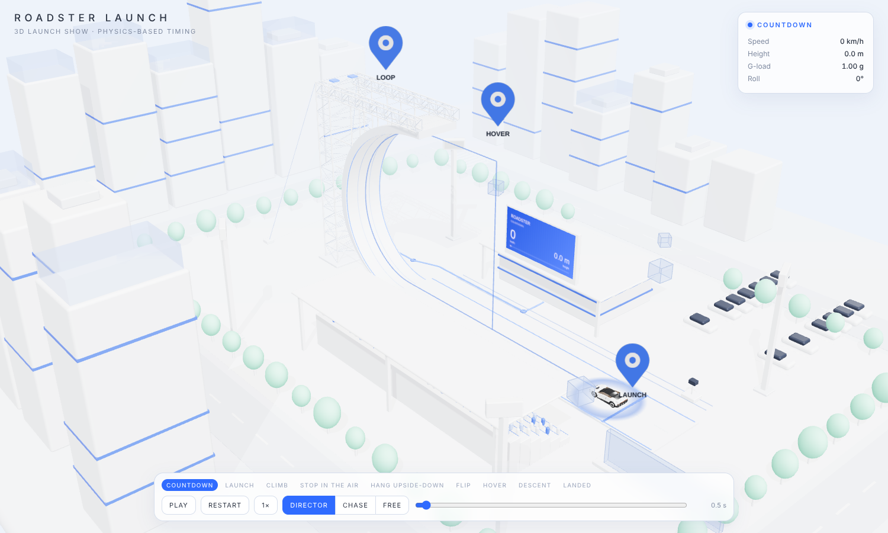
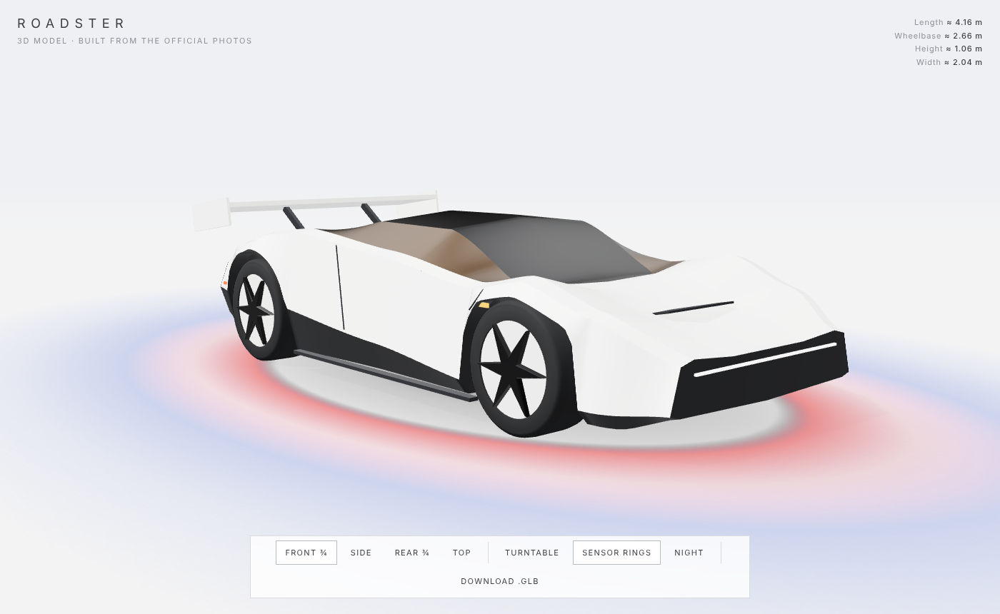
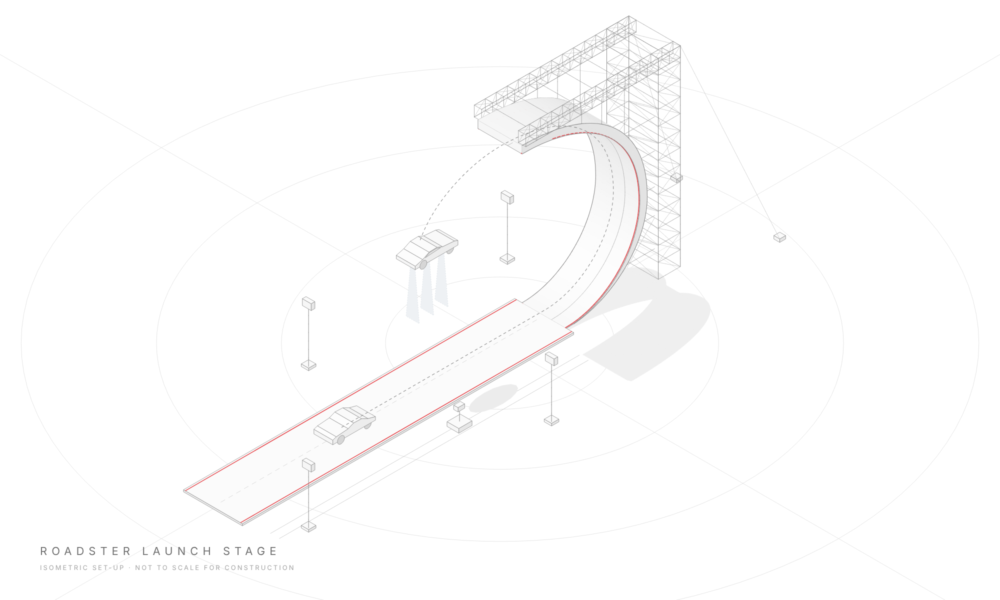
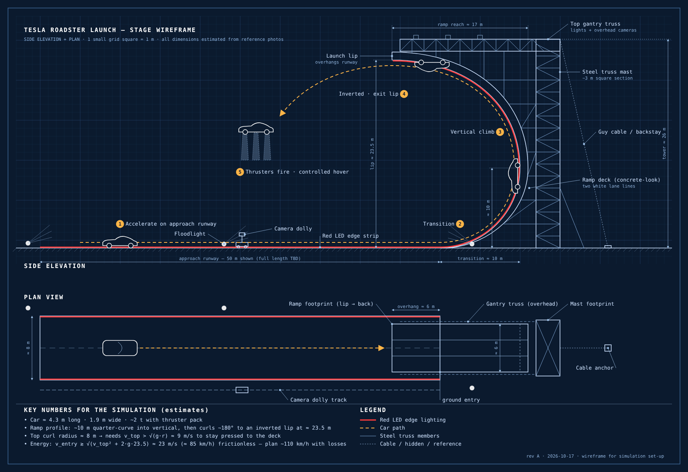

# Tesla Roadster launch — simulation

**3D launch show:** open [`launch-3d.html`](launch-3d.html). The full launch runs in a white diorama city (C-ramp and truss tower, grandstand, pavilion with a live screen, floodlights, parking, trees, ring roads, glass decor and location pins) using the 3D Roadster and the same physics as `simulation.html`. Cameras: Director (a framed shot per phase), Chase, or Free orbit. **Free Drive** turns it into a game: hold W (or ↑) to drive, S (or ↓) to brake and reverse, R to reset. Keep your speed on the wall or you slide back; reach the lip and the car flies, rolls, brakes on its thrusters and lands, then you can drive it down the runway. On touch screens use the on-screen W, S and R buttons.

**3D model:** open [`roadster-3d.html`](roadster-3d.html) for an interactive 3D Roadster built from the official photos (studio white or night lighting, sensor rings, turntable, view presets). **Download .glb** exports the model for Blender, Unity or three.js.

**Simulation:** open [`simulation.html`](simulation.html) in a browser. The car launches down the runway, climbs the ramp, leaves the lip upside-down, brakes to a stop in mid-air on thrusters, flips upright, hovers and lands. Thruster jets fire out of the car floor and turn with the car (up while it hangs upside-down, down after the flip), drawn as a particle gas stream that spreads into a cloud when it reaches the runway. Controls: play/pause (space), restart, speed (1× / 0.5× / 0.25×), follow camera, night mode, timeline scrubber.

Step 1: drawings of the stage set-up, based on the reference photos.

- `stage-wireframe.svg`: side elevation and plan view, drawn to scale (1 m grid)
- `stage-isometric.svg`: isometric line illustration of the same stage (3D model projected in `build_isometric.py`)
- `build_wireframe.py`: generates the SVG; change the numbers here and run `python3 build_wireframe.py` again

All dimensions are estimates from the photos. Approach runway length, the exact ramp curve and the thruster details are still open.
